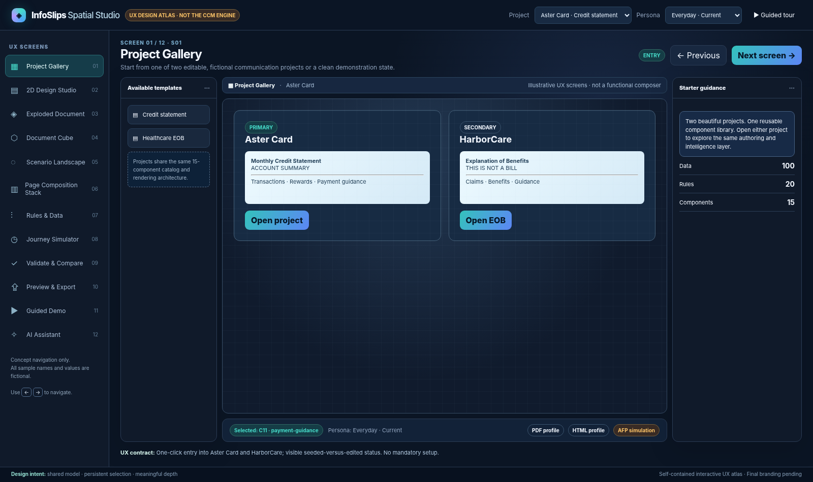
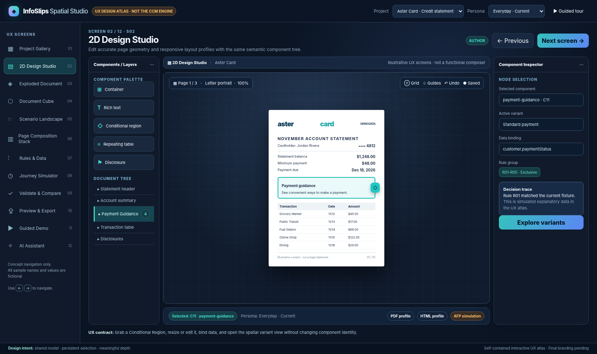
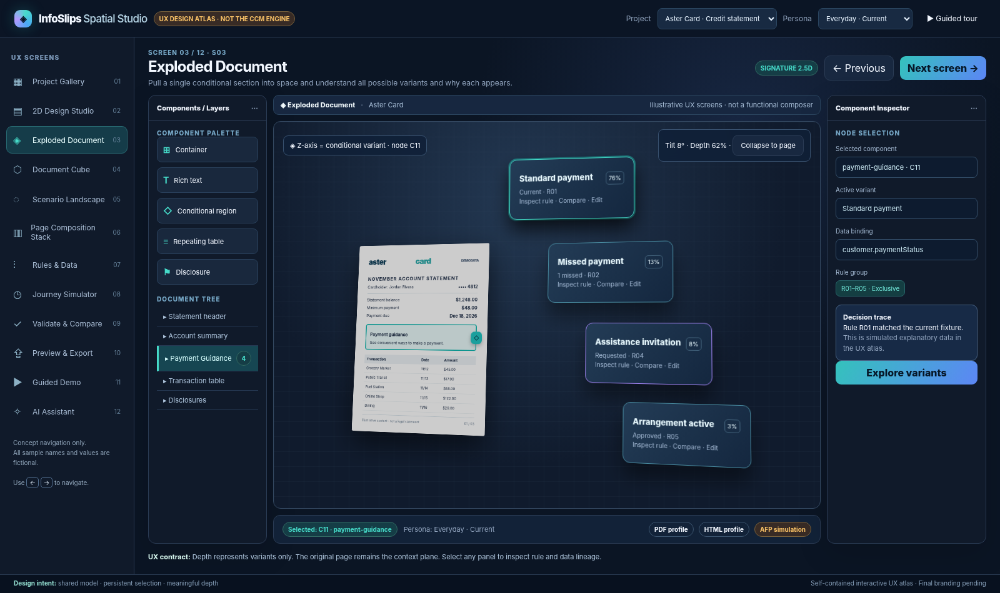
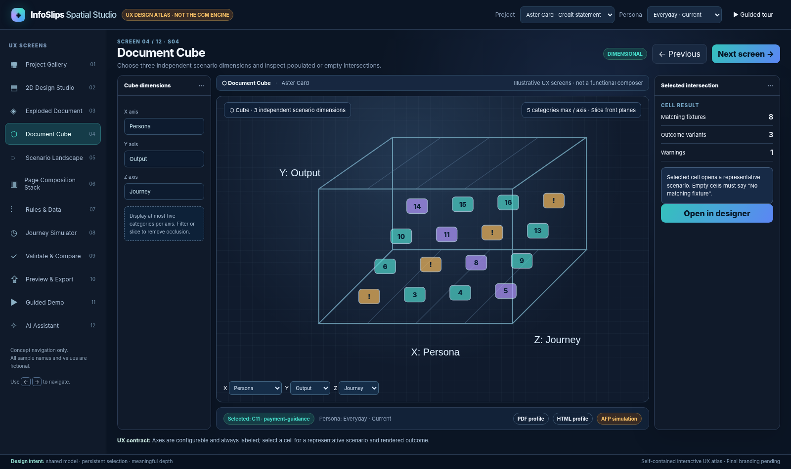
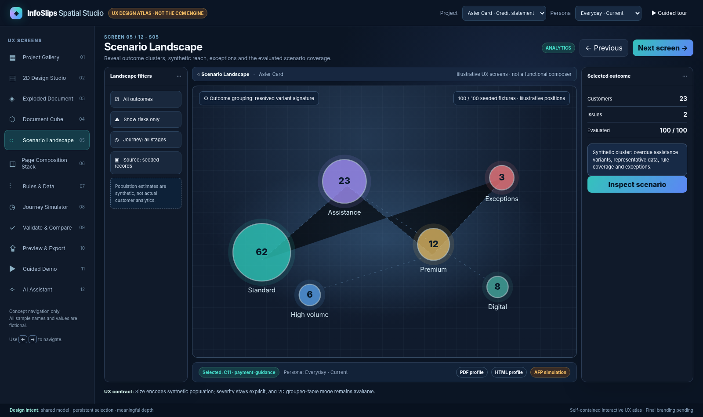
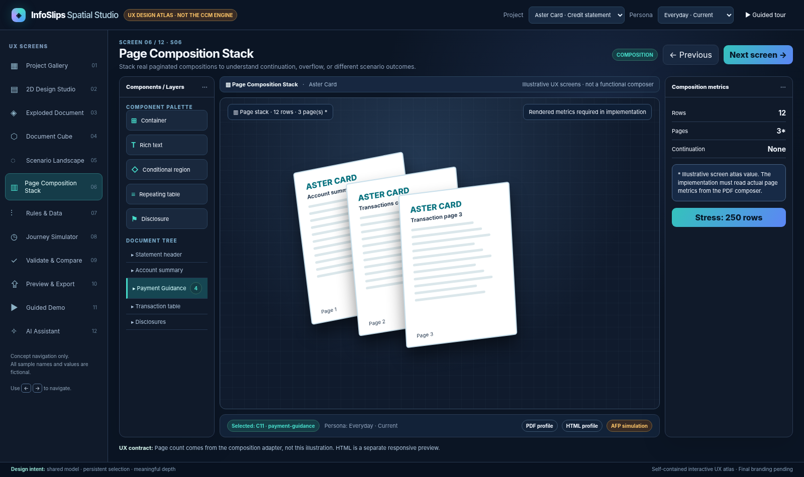
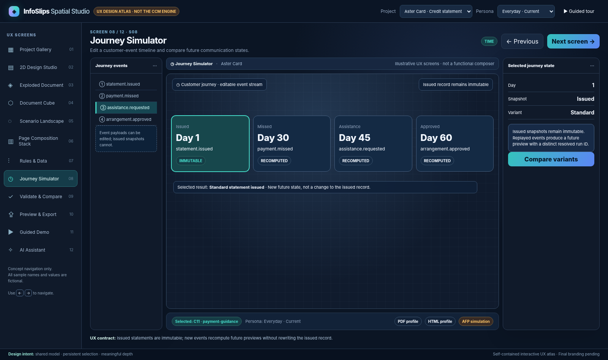
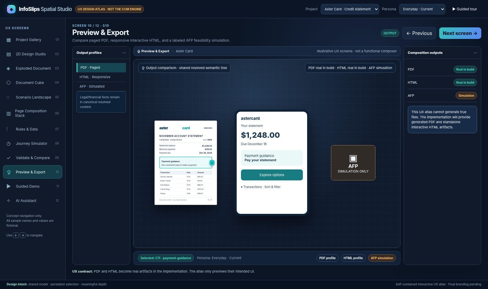

# InfoSlips Spatial Studio
## Screen-by-Screen UX Blueprint and Interaction Specification

**Version:** 1.0  |  **Date:** 12 November 2026  |  **Status:** Design-ready companion to the approved POC/MVP Build Specification v1.0

**Audience:** UX/product designers, frontend engineers, visualization engineers, test engineers, and business/technical stakeholders.  
**Approval basis:** Rounds 1–3 and final architecture decisions.  
**Brand assets:** Pending InfoSlips supply. **Publishing destination:** Pending instructions at deployment stage.

> **Design thesis:** Design in 2D. Understand in 2.5D. Simulate through rules and time. Compose into real PDF and interactive HTML. The 2.5D views must reveal meaningful structure, not simply add perspective effects.

## 1. How to use these deliverables

The companion **Interactive UX Atlas** is a self-contained HTML concept walkthrough with twelve selectable screens and limited illustrative interactions. It is **not** the functioning CCM engine. Its invented counts, page numbers, and diagnostics are labeled as illustrative. This blueprint specifies what the production POC must actually do. The **Implementation Plan** defines the build order, architecture, work packages, validation gates, and ownership.

The HTML atlas visualizes the proposed visual language: dark workstation frame, white document planes, cyan active selection, restrained violet for alternatives, amber for warnings, and red for errors. Brand-specific tokens replace these placeholders when official assets arrive.

## 2. Information architecture and routes

The studio is a **single contextual workbench** with distinct views, not multiple disconnected applications.

| ID | Route concept | Screen | Role |
|---|---|---|---|
| S01 | `/projects` | Project Gallery | Open/create/reset demo projects |
| S02 | `/studio/:project/design` | 2D Design Studio | Canonical authoring surface |
| S03 | `/studio/:project/exploded/:nodeId` | Exploded Document | Inspect named conditional variants |
| S04 | `/studio/:project/cube` | Document Cube | Explore configurable 3-axis scenario space |
| S05 | `/studio/:project/landscape` | Scenario Landscape | See outcome groups, impact, risks |
| S06 | `/studio/:project/page-stack` | Page Composition Stack | Compare actual composed page behavior |
| S07 | `/studio/:project/rules-data` | Rules & Data | Author rules, edit fixtures, inspect trace |
| S08 | `/studio/:project/journey` | Journey Simulator | Edit/replay events; preserve issued history |
| S09 | `/studio/:project/validate` | Validate & Compare | Run checks; jump to the exact cause |
| S10 | `/studio/:project/outputs` | Preview & Export | Real PDF, interactive HTML, AFP simulation |
| S11 | `/studio/:project/demo` | Guided Demo | Presenter-led, repeatable narrative |
| S12 | `/studio/:project/assistant` | AI Assistant | Explore/describe, propose guarded actions |

**Overlays and task surfaces:** O01 Variant Comparison; O02 Rule Builder; O03 Field Token Picker; O04 Data Record Editor; O05 Journey Event Editor; O06 Validation Detail; O07 Export Job; O08 AI Action Approval; O09 Save/Reset Confirmation. These are overlays/drawers, not nine additional full-screen destinations.

### 2.1 Shared shell layout

**Target:** 1440×900 reference viewport, with 1280×720 usable by collapsing sidebars. The design atlas is shown at larger widths for clarity.

| Zone | Proposed width / behavior | Persistent responsibilities |
|---|---|---|
| Top bar | ~60 px high | Project, view, persona, output profile, undo/redo, save, demo, AI status |
| Left navigation | 200–220 px, collapsible to icons | Screen modes; current mode; keyboard destination |
| Left work panel | 175–230 px, context-sensitive | Component palette and Layers; scenario filters; rules list |
| Center | Takes available space; min 560 px on desktop | Real editor or spatial projection; canvas-specific controls |
| Right inspector | 260–330 px; collapsible | Content, Data, Rules, Layout, Accessibility, Impact tabs |
| Bottom dock | 45–80 px, expandable | Active persona, scenario, journey marker, validations, compose jobs |
| AI utility | Docked drawer, never covers selected component | Natural-language commands, provenance and approval |

**Shared context state:** `projectId`, `modelVersion`, `selectedNodeId`, `activeScenarioId`, `selectedPersonaId`, `journeyCursor`, `outputProfileId`, `spatialMode`, `spatialFilters`, `activeValidationIssue`. A change to context resolves only the necessary projections; an unsaved edit marks the model dirty.

### 2.2 Navigation and feedback rules

1. Selecting a component in the page, layers tree, exploded panel, diagnostic, or output provenance maps to the **same stable semantic node ID**.
2. Opening a spatial view preserves `selectedNodeId`. Returning to design restores page, zoom, selection, and scroll where possible.
3. If the selected node is suppressed by the current scenario, keep it selected in the Inspector and show **“Not rendered in this scenario”** with explanation.
4. Camera drag/tilt never moves actual document components. Show explicit mode-specific cursor and gesture hints.
5. Distinguish **source model changed** from **preview scenario changed**. Save applies only to model edits; persona/time switching does not dirty the source template.
6. Every operation that changes content or rules records an undoable command and a visible result or structured error.
7. Long-running compose/validate jobs show progress and cancellation or retry; never replace failed results with invented success states.

## 3. Screen 01 — Project Gallery

**User goal:** Choose the two approved demonstration projects quickly, with full confidence that sample data is synthetic and restorable.  
**Primary personas:** Executive, presenter, designer.  
**Entry:** App root, project switcher, Demo Reset action.

**Layout:** Two visually rich project cards centered on the canvas: Aster Card Credit Statement (primary/hero) and HarborCare Healthcare EOB (secondary). Each card displays a credible mini-preview, last saved version, seeded/modified indicator, and an **Open project** primary action. Auxiliary actions: **Restore approved sample**, **Duplicate demo project** (optional), **Export project JSON**. A side panel shows counts: 15 component types, 20 seeded rules, 100 synthetic records.

**Behavior:** Open preserves project-scoped state; change project clears only incompatible selection references. Reset requires confirmation and creates a new undo boundary. The gallery must not imply that synthetic data is a production data connection.

**States:** Empty project list (show seed-import action); modified fixture (dirty marker); load failure (retry/error code); reset confirmation.  
**Accessibility:** All cards keyboard accessible with semantic headings and meaningful link/button labels.  
**Acceptance:** Open both projects; reset and reopen deterministic fixtures; no invisible project switching.

## 4. Screen 02 — 2D Design Studio

**User goal:** Build or modify a real document structure by dragging and resizing components and editing text, bindings, layout, and variants.  
**Primary personas:** CCM designer, implementation specialist.  
**Entry:** Open project; navigation from any projection using **Open in designer**.

**Layout:** Left palette with searchable categories and the hierarchical component tree; center white page at true physical aspect ratio, with rulers, safe area, page guides, flow-region outlines, selection handles and snapping cues; right Inspector with **Content | Data | Rules | Layout | Accessibility | Impact**. A target profile switcher chooses **Paged (PDF/AFP conceptual)** or **Interactive HTML**, preserving the selected semantic node. The document must remain legible at 100% and reflow sensibly with zoom.

**Authoring gestures:**

- Drag a component from palette to a valid document region; hover shows insertion ghost and drop target; release creates one model command and one undo entry.
- Single click selects; double click edits rich text; Esc exits text mode without losing node selection. Resize handles honor min/max constraints; arrow keys nudge; Shift enables larger nudge; keyboard alternative to drag is **Insert component** plus property inputs.
- Align, duplicate, delete, lock, group/ungroup (within supported model), reorder and move to a different permitted container. Invalid drop shows specific reason and leaves model unchanged.
- A conditional component exposes a prominent **Explore variants** handle, not a permanent 3D tilt on every element.
- Insert typed `{{customer.givenName}}` style tokens from O03 field picker; missing or incompatible tokens produce a typed validation warning.
- Fixed anchors and flow regions remain visually distinct; a repeating table can cross page boundaries only in a flow region with continuation rules.

**States:** New component; dirty; saved; selected but suppressed; locked; page-overflow risk; token missing; invalid drop; text editing focus; PDF versus HTML profile mode.  
**Accessibility:** Full keyboard authoring for supported operations, visible focus, labels, zoom and high contrast; text editing always in DOM.  
**Acceptance:** Drag C11 conditional section, bind field, create/edit two variants, undo, save/reload, verify same semantic ID in S03 and S10.

## 5. Screen 03 — Exploded Document (signature experience)

**User goal:** Reveal what a selected document section can become and why, without losing its original context.  
**Primary personas:** All audiences; primary stakeholder wow moment.  
**Entry:** Select `C10` or `C11` in S02, choose **Explore variants** or use the dedicated pull handle.

**Layout:** The original document stays visible as the base plane on the left. An animated depth separation reveals one floating, labeled projection for each named variant (including fallback). Thin connectors lead from the source region to the variant panels. Each panel shows content preview, conditions, matched rule IDs, synthetic reach, and diagnostic flags. Selection is reflected in the Inspector. Provide **Compare**, **Inspect rule**, **Edit variant**, **Collapse**, **Reset camera**, **Flat alternative**.

**Depth meaning:** Exactly one: Z = *alternative outcomes of this component*. Depth must not encode the passage of time or physical page count here. Perspective is constrained (gentle tilt, small bounded camera travel). Printed font sizes should not be rendered tiny merely to create a dramatic scene; panel text remains legible and can open a flat detailed comparison.

**Interaction contract:** Opening retains `selectedNodeId`; selecting a panel sets `selectedVariantId` without overwriting canonical content. Clicking **Inspect rule** opens S07 focused on the match; **Compare** opens O01 2D side-by-side diff; **Edit** returns to S02 focused on canonical variant. `Collapse` animates the correct panels into the original section and restores exact page selection. Only a confirmed content/rule edit dirties the project.

**Animation choreography:** source highlight (0–80 ms) → paper holds spatially (80–150 ms) → panels separate (150–400 ms) → connective rule labels appear (250–450 ms). These are proposed motion targets, not application latency guarantees. Reduced motion removes transitions instantly.  
**States:** 1 variant (show no misleading explosion); 4+ variants; missing fallback; rule overlap; no matched variant; selected suppressed variant; offline/performance fallback.  
**Acceptance:** Variant cards derived from model; selecting a rule updates trace; changing a rule changes selected resolved variant and corresponding PDF/HTML, with selection preserved.

## 6. Screen 04 — Document Cube

**User goal:** Compare outcomes at intersections of three independently configurable categorical dimensions.  
**Primary personas:** CCM architect, QA, business owner.  
**Entry:** Spatial navigation, related action from S03/S05.

**Layout:** The cube occupies the center; persistent axis labels and a legend are visible outside the scene. An **Axis Configurator** chooses X/Y/Z from allowed, typed dimensions: persona, output profile, journey state, language, payment status, account tier, claim status, network status. Faceted filter chips and a depth slicer manage occlusion. Side Inspector shows the selected cell: exact matching records, output target, selected outcome, notable rules and issues. Provide a conventional 2D matrix fallback.

**Behavior:** A selection must represent a genuine scenario intersection (not arbitrary node position). Reject the same dimension on multiple axes with a helpful message. Max five categories per axis displayed at one time; additional values are filtered/paged. Empty intersection = **No matching fixture**. For AFP target, show **SIMULATION ONLY** instead of a downloadable AFP output.

**States:** Default preset persona × output × journey, user-configured axes, empty/invalid combination, dense cube needing slicing, loaded/partial scenario coverage, 2D fallback.  
**Accessibility:** Axis selectors as ordinary controls; cells accessible through sortable table with equivalent counts and actions.  
**Acceptance:** Swap axis; count and selected outcome update consistently; duplicate axis blocked; cell opens correct resolved scenario.

## 7. Screen 05 — Scenario Landscape

**User goal:** Discover common resolved outcomes, minority variants, defects, and approximate impact in the synthetic dataset.  
**Primary personas:** Business owner, QA, architect, executive.  
**Entry:** Landscape navigation, **Show impact** from Inspector.

**Layout:** 2.5D cluster landscape with one cluster per outcome signature. Affected seeded-record count determines bubble area (with numerical annotation). Color and explicit icon indicate severity. Selected elevation metric (rule complexity, exception count, or mean rendered page count) appears in legend and tooltip. A right inspector lists affected fixture IDs, contributing rules, representative records, and **Open scenario** / **Show defects** actions. A coverage bar always states **N evaluated / M planned**.

**Behavior:** Outcome signature includes named selected variant IDs, relevant conditional sections, selected output and journey state. Grouping is deterministic; spatial positions are stable for the same signature set. Clearly distinguish 100 seeded records from extra generated combinations and any weighted illustration. Never present synthetic reach as customer analytics.

**States:** All scenarios; filtered; defects only; no results; partial resolution; offscreen clusters; data lineage/coverage warning.  
**Accessibility:** A grouped table with counts and actionable links is mandatory; labels do not rely on size/color alone.  
**Acceptance:** Cluster totals reconcile to active sample universe; clicking a cluster opens one valid representative scenario; exceptions link to validation.

## 8. Screen 06 — Page Composition Stack

**User goal:** Compare actual paged output geometry as content, language, or scenario changes.  
**Primary personas:** Production engineer, CCM designer, QA.  
**Entry:** Spatial navigation, **Inspect pagination** from validation, or result from export.

**Layout:** Stack/fan of actual page thumbnails generated by the composition adapter. Page labels, continuation headers, affected node outlines and diagnostics overlay the thumbnails. Compare modes: **Same customer across time**, **Different personas**, **Before/after rule change**. A slider adjusts page separation; flat page list is available. Inspector shows real page count, row count, continued components, source run ID, and overflow diagnostics.

**Behavior:** Stress toggle generates 250 synthetic transactions and recomposes. The displayed page count **must come from the real PDF layout engine**, not a hard-coded number or a heuristic. An intentionally disabled continuation produces a genuine diagnostic and red overlay. Cross-page differences map by node IDs, not by assuming the same content remains on the same page number. HTML is shown as a responsive sibling preview rather than treated as physical paper.

**States:** PDF job queued/running/complete/failed; N=1 page; many pages requiring virtualization; overflow; page mismatch; no composition; before/after comparison.  
**Accessibility:** Page thumbnails have numbered list and diagnostics text table.  
**Acceptance:** 12→250 rows modifies real composer metrics; continuation headings repeat; values reconcile; overflow issue navigates to source region.

## 9. Screen 07 — Rules & Data

**User goal:** See and safely edit the exact conditions behind document outcomes and the data that influences them.  
**Primary personas:** CCM developer, designer, compliance reviewer.  
**Entry:** Rules navigation, Inspector **Show rule**, AI explanation link.

**Layout:** Left tree groups rules by exclusive, additive, obligation, and domain. Center condition builder uses field picker, operator, typed value, logical group and action. Toggle **Visual** / **Advanced AST**; the latter edits validated declarative JSON, never arbitrary JS. Right side shows matched fixture count, precedence, conflicts, trace, impacted components and **Test rule**. Data editor O04 allows synthetic record inspection/overrides; token picker O03 reveals schema and types.

**Behavior:** An edit is validated before commit; invalid syntax does not affect the last good resolution. Reordering precedence updates traces and highlights exclusive overlaps. Obligations cannot be suppressed by cosmetic variation. Rule R05 precedence over R04/R03/R02/R01 should be inspectable. Contradictory input (current + 2 missed payments) shows an input-consistency diagnostic rather than quietly selecting a variant.

**States:** Draft rule, valid, conflict, unreachable within bounded fixture domain, no-match, unsaved change, concurrent save conflict, affected scenario preview.  
**Accessibility:** Conditions editable by labeled form controls and keyboard.  
**Acceptance:** Change R03 condition; see evaluated fixtures and selected variant change; undo restores; trace cites the rule and input values.

## 10. Screen 08 — Journey Simulator

**User goal:** Demonstrate that customer events change future communications without rewriting issued records.  
**Primary personas:** CX leader, designer, architect.  
**Entry:** Journey navigation or **Explore over time** from S03.

**Layout:** Horizontal event timeline and editable event cards at Day 1, 30, 45 and 60. Use distinct styling for **Issued / frozen** versus **Preview / recomposable**. Selecting a card reveals event type, payload, prior state, resulting state, selected content variant, and **Compare snapshots**. A right-hand document preview updates with scrub cursor. **Add event**, **Edit event**, **Remove event**, **Replay**, **Reset** operate through O05.

**Behavior:** Replaying from a known seed is deterministic. Day 1 statement issued generates an immutable snapshot; Day 30 missed payment produces a new preview; Day 45 assistance request selects supportive message; Day 60 approved arrangement selects active arrangement. An event order change must rerun rules and invalidate dependent preview cache without altering issued artifact hash.

**States:** Valid sequence, invalid event order, incomplete payload, issued immutable snapshot, before/after diff, replay working/error, unsaved event changes.  
**Accessibility:** Fully operable event list besides the timeline; no scrubbing-only functionality.  
**Acceptance:** Event edits change later variants; issued Day 1 digest stable; diff shows semantic changes with rule explanations.

## 11. Screen 09 — Validate & Compare

**User goal:** Find an authentic issue, understand its impact, and jump to its source.  
**Primary personas:** QA, technical stakeholder, business reviewer.  
**Entry:** Validate navigation, diagnostic badge, export preflight.

**Layout:** Overview counters by severity, four check suites (rules, pagination, semantic parity, basic accessibility), a filterable issue list, and a detailed issue drawer (O06). Each issue includes stable code, affected node/rule IDs, scenario/run, reproduction steps, severity and **Go to source**. Two-up output comparison shows affected semantic values if parity failed.

**Seeded defect demonstrations:** D01 conflicting exclusive outcome with equal precedence; D02 missing approved Spanish mandatory disclosure variant; D03 page overflow when continuation disabled; optional D04 unconfirmed EOB liability shown as due. Findings must be generated by real validators, not hard-coded user-facing notices. The visual atlas displays illustrative examples only.

**States:** Not run, validating, clean, warnings, errors, partial coverage, run failed; archived report from prior model version.  
**Accessibility:** Results are a navigable list with textual severity and focus management into details.  
**Acceptance:** Turning D01–D03 on yields exact relevant defects; fixing underlying model clears the issue on rerun; navigation selects correct node.

## 12. Screen 10 — Preview & Export

**User goal:** Verify the actual rendered communication and retrieve the usable output artifact.  
**Primary personas:** Designer, technical stakeholder, executive.  
**Entry:** Output navigation; **Compose** from S02; Demo step.

**Layout:** Three output tabs: **PDF (real)** with embedded page preview and Download, **HTML (real)** with device width switch (desktop/tablet/mobile), interactive transaction table and expandable details, **AFP (simulated)** with page/media/duplex/resources conceptual checklist and permanent simulation label. A semantic parity indicator compares shared required data and disclosure IDs, not pixel-for-pixel appearance. Export history shows resolved run ID, source model version, scenario, time, artifact hash, and composition status.

**Behavior:** PDF and HTML are produced from the same resolved semantic tree with separate layouts. Clicking sorting/filtering in HTML does not mutate the financial totals or rule decision. Print fallbacks for interactive actions are explicit URLs/QR. AFP tab never offers .afp download. Compose failure shows actionable error and retry; outdated preview is marked stale after model changes.

**States:** Pending, queued, composed, stale, failed, empty fixture, semantic parity mismatch, AFP simulation.  
**Accessibility:** Keyboard view switching, PDF page summaries, accessible standalone HTML.  
**Acceptance:** Real files generated from current run; data/disclosures consistent; AFP clearly simulated; no invented page count.

## 13. Screen 11 — Guided Demo

**User goal:** Deliver an engaging, resilient narrative in seven to eight minutes, using real app state.  
**Primary personas:** Presenter and stakeholders.  
**Entry:** **Start guided demo** from Gallery/top bar.

**Layout:** Minimal narration banner, chapter indicator and Next/Pause/Explore freely/Reset. No modal takeovers that obscure the core visualization. Chapter headings explain the user benefit in plain English. A checkpoint badge indicates the seed/model version and whether internet-dependent features are optional.

**Chapter choreography:** (1) Familiar page; (2) explode conditional payment section; (3) swap persona; (4) author/change rule; (5) Cube and Landscape; (6) journey; (7) 250-row Page Stack; (8) PDF/HTML export; quick HarborCare EOB and AI explanation when time permits. Exact script and recovery paths are in the Implementation Plan.

**Behavior:** Guided steps invoke the same commands as manual UI. Presenter may pause and modify data; **Resume demo** reestablishes preconditions or clearly requests reset. Live AI timeout must never stall the presentation; fallback uses deterministic local commands and known scripted prompts.

**States:** Ready, running, paused, explorer detour, checkpoint mismatch, reset confirmation, offline fallback.  
**Accessibility:** Narration content as text, full keyboard operation, reduced motion.  
**Acceptance:** Two consecutive demo runs on clean local machine with deterministic checkpoints and no stale project state.

## 14. Screen 12 — AI Assistant

**User goal:** Use natural language to explore scenarios and obtain evidence-backed explanations without surrendering control of authoring.  
**Primary personas:** Designer, executive, architect.  
**Entry:** Floating assistant button or dedicated view.

**Layout:** Conversation thread; highlighted extracted scenario parameters; provider badge **Live / Offline fallback**; **Preview action** and **Apply scenario** controls; trace links; for any edit recommendation, a review diff dialog O08 with **Approve / Reject**. Example prompt: “Show a customer with two missed payments who requested assistance; explain why the assistance copy appears.”

**Behavior:** AI turns natural language into typed, allowlisted actions: choose fixture, set scenario override, change view, explain recorded rule trace, request validation, propose an edit. It never directly runs JavaScript or changes mandatory disclosures. The resolver and rules engine alone determine what appears. If provider fails, a clear fallback badge appears and deterministic command patterns continue working. Provider response text is not used as legal/compliance truth.

**States:** Awaiting prompt, interpretation pending, ambiguous parameters, proposed action, approved/rejected change, provider failure, fallback ready, explanation with trace not found.  
**Accessibility:** Accessible chat history and review dialog; no auto-apply on Enter.  
**Acceptance:** AI proposal must be reviewed before an edit; explanation cites actual rule trace; provider failure preserves core POC.

## 15. Overlay specification

| Overlay | Entry | Fields/actions | Exit / impact |
|---|---|---|---|
| O01 Variant Compare | S03 Compare | Select two variants; text/field diff; rule trace | Return to S03 with selected node/variant intact |
| O02 Rule Builder | S07 edit / Inspector | Field, operator, typed value, group, outcome, priority, test | Validate then commit one undo command; errors stay local |
| O03 Token Picker | Rich-text Insert token | Typed schema search, example value, null policy, formatter | Inserts structured token, not plain executable markup |
| O04 Sample Data Editor | S07 record / persona | Editable synthetic fields, diff, reset, edge-case generator | New scenario snapshot; does not silently modify base model |
| O05 Event Editor | S08 Add/Edit | Event type, day, payload, issue/preview flag | Replay event stream; freeze issued output |
| O06 Validation Detail | S09 issue | Severity, reproducible input, impacted nodes/rules, correction | Navigate source with selection preserved |
| O07 Composition Job | S10 compose | Target, progress, run ID, error, artifact | Download real file, retry/cancel; AFP sim report only |
| O08 AI Action Approval | S12 suggestion | Structured proposed change, before/after, rule check, Approve/Reject | Explicit user command, auditable undo entry |
| O09 Reset/Discard | Gallery/Studio | Scope (scenario/project/demo), affected edits, confirm | Recreate known seed; no hidden destructive action |

## 16. Fifteen-component UX behavior matrix

All 15 catalog items are **placeable and selectable**. Depth of editor behavior is deliberately prioritized.

| ID | Authoring gesture / Inspector controls | Spatial and preview behavior |
|---|---|---|
| C01 Container/Section | Drag nested target, stack/flow, padding, alignment | Child semantic hierarchy; selectable region |
| C02 Rich Text | In-place rich editor, token picker, format constraints | Content differences visible per variant; text copied to outputs |
| C03 Image/Logo | Upload demo image, fit/crop, alt text | Paper/HTML object with target-specific scale |
| C04 Shape/Divider | Draw/resize, stroke and fill | Decoration excluded from semantic parity if flagged |
| C05 Header/Footer | Repeat/margins/page region options | Page repetition; HTML site/document header equivalent |
| C06 Bound Field | Token path, type formatter, null strategy | Value updated with scenario; traceable to source path |
| C07 Repeating Table | Bind array, columns, repeat heading, row template | Page continuation; HTML sort/filter; stack diagnostics |
| C08 Summary/Metric | Formula or bound value; labels | Same semantic value, layout adapted per output |
| C09 Chart | Data field, bar/donut, accessible summary | Static PDF graphic and interactive HTML counterpart |
| C10 Conditional Region | Rule set/mode/visibility constraints | Expand conditional outcomes; selected match shown |
| C11 Variant Set | Named variants, exclusive priority, fallback | Signature exploded panels, rule chips |
| C12 Disclosure | Mandatory/jurisdiction/version, protected editing | Required in all relevant output manifests |
| C13 Action/Link | Safe destination, label and print fallback | HTML action vs printed URL text |
| C14 QR Code | URL validator, sizing, quiet zone, caption | Paged QR vs HTML link; no unsafe code execution |
| C15 Expandable Explanation | Summary/details, association, expand state | PDF expanded appendix/summary vs HTML details control |

## 17. Interaction flows that must feel like one product

### F01: Create → Explode → Explain → Export

Open Aster Card (S01) → select C11 Payment Guidance in S02 → choose Explore → S03 reveals alternatives tied to C11 → select “Assistance invitation” → Inspector shows R04 / input trace → jump to S07 and modify allowed rule → return to S03 (still C11 selected) → generate S10 PDF and HTML → see one semantic outcome with distinct presentation profiles. **Pass:** no duplicated variant data, no lost selected node, no false export.

### F02: Stress test page flow

From S02 select transaction table → S07 sample editor sets 250 rows → compose PDF → S06 Page Stack shows measured page count and repeated headings → disable continuation via permitted POC property → S09 displays actual overflow issue → return to source and fix → rerun and clear. **Pass:** diagnostic is produced by renderer/validator, not mocked.

### F03: Customer journey drives future communications

S08 select Day 1 issued → record immutable snapshot → add payment missed → assistance request → compare selected future preview with issued snapshot in S03/S06. **Pass:** issued snapshot hash unchanged; later resolved run distinct and traceable.

### F04: Different document, same engine

S01 open HarborCare EOB → S02 renders insurance components including **THIS IS NOT A BILL** → S07 select denial review fixture with `liabilityConfirmed=false` → S09 confirms no unsupported debt demand → S10 produces semantic-consistent PDF/HTML. **Pass:** no banking-specific engine assumption.

### F05: AI safe exploration

S12 prompt for missed payments and Spanish preference → safe structured scenario preview → approve scenario navigation (non-authoring action) → S03/S02 reflect resolution → ask why; display trace → AI suggests a rule change → O08 approval required before edit. **Pass:** live model can fail and deterministic fallback still completes the scenario.

## 18. Motion, visual system and accessibility

**Theme placeholders (replace on brand delivery):** app background #080f1e; chrome #101a2a; paper #ffffff; primary selection #46dbc9; spatial alternative #b399ff; warning #f9c267; error #fb7c83; text #f2f7ff; muted #91a4be. Use CSS custom properties and semantic tokens, not embedded brand graphics.

**Type scale:** 11–12 px compact metadata, 13–14 px controls, 16 px body/inspector emphasis, 22–28 px page headings, 30–40 px guided-demo statement. Critical data must not be hidden behind hover-only labels. Minimum target size and contrast should be reviewed against WCAG 2.2 AA goals; future project-wide conformance is not claimed by the POC.

**Spatial motion:** 200–450 ms for unfolding/tilt transitions; selected node persists and gets a consistent cyan outline. Do not rotate the entire app; animate only the visualization plane. Respect `prefers-reduced-motion`; retain a flat equivalent. Never use camera motion as the only way to reveal a rule relationship.

**Keyboard and assistive alternatives:** top-level navigation via tab/shortcuts; component tree and flat variant list; labeled axes and scenario cells as table; accessible page list and issue list; focus return to initiating control after dialog; screen reader labels include variant/rule/scenario ID; error messages identify corrections.

**Responsive:** 1440×900 ideal; at 1280×720 collapse one side inspector; at narrower viewports use a drawer with primary desktop capability. Mobile design is **for exported HTML communications**, not a promise of mobile authoring parity in the POC.

## 19. UX test and review checklist

| UX-ID | Review task | Measurable success |
|---|---|---|
| UX-01 | Find payment component on first entry | Correct selection within 30 seconds for new stakeholder |
| UX-02 | Go from page to Exploded and back | Same node selection; no lost zoom/context |
| UX-03 | Identify why assistance appears | Correct rule + matched field shown, not only AI prose |
| UX-04 | Change Cube axis and inspect cell | Axis labels, counts and empty-state behavior unambiguous |
| UX-05 | Compare Landscape groups | Every cluster has explicit count and synthetic-data labeling |
| UX-06 | Find source of overflow | From Page Stack marker to flow property within 2 actions |
| UX-07 | Create and undo component change | One understandable undo transaction, save status correct |
| UX-08 | Trigger journey event | Future preview updates; issued record unchanged |
| UX-09 | Review AI change proposal | No authoring change without explicit approval |
| UX-10 | Explain real vs simulated output | PDF/HTML real, AFP simulation unmistakable |
| UX-11 | Operate without pointer | All essential insights available by keyboard/2D alternative |
| UX-12 | Run demo twice | No stale state, reliable reset and offline fallback |

## 20. Design handoff and exclusions

**Design handoff consists of:** this UX blueprint; self-contained HTML atlas; screenshots; a design-token map; interaction flows; component states; screen-level acceptance tasks; and the approved comprehensive product specification. The HTML atlas is a **visual storyboard** and contains no genuinely integrated rules, PDF generator, artificial intelligence, or publication configuration. The source of truth for build behavior is the written specification and the existing fixture bundle.

**Still pending only when required:** (1) the official InfoSlips logo, brand palette, fonts, and styling guidelines for visual integration; (2) final deployment destination and credentials/domains for publishing. Neither is needed for the design/engineering first slice.
